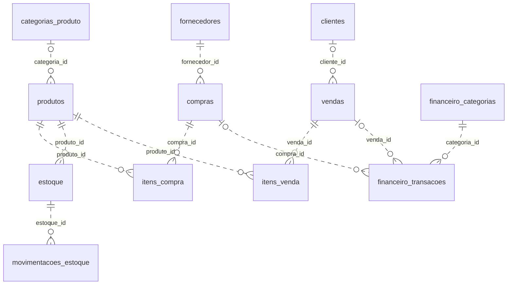

# Banco de dados — FarmaControl

Consolidado em **11/11/2026**; referência de estrutura revisada em **19/10/2026** a partir do [schema](../backend/schema.sql) e das [migrações](../backend/migrations). Esta revisão não consultou nem alterou um servidor de banco.

## Instalação e compatibilidade

O schema cria a base `farmacontrol` com `utf8mb4` e tabelas InnoDB. Inclui 24 tabelas, perfis, categorias e configurações iniciais. Roles técnicas são provisionadas separadamente. Não cria automaticamente uma conta administrativa da aplicação com senha.

Use-o em uma instalação nova. Em base existente, compare estrutura e migrações; `CREATE TABLE IF NOT EXISTS` não atualiza todas as colunas, índices ou dados de uma tabela antiga. O schema base é verificado pelo CI em MySQL 8 e MariaDB 10.4; não executa roles ou concessões globais. Veja [instalação e diagnóstico no XAMPP](#mysql-xampp).

## Tabelas

| Tabela | Responsabilidade |
| --- | --- |
| `perfis` | Cargos funcionais da aplicação |
| `perfil_permissoes` | Módulos concedidos por perfil e consultados pelo middleware |
| `usuarios` | Identidade, senha bcrypt, perfil, status e recuperação |
| `analises_cadastro` | Decisões de aprovação/rejeição |
| `log_acessos` | Registros de tentativas de acesso |
| `clientes` | Clientes vinculáveis a vendas e receitas |
| `categorias_produto` | Classificação comercial |
| `fornecedores` | Fornecedores de produtos/compras |
| `produtos` | Cadastro comercial, tipo, preços e regras de validade/receita |
| `estoque` | Saldo por produto/lote e validade |
| `movimentacoes_estoque` | Histórico de alterações de saldo |
| `compras` | Cabeçalho e estado do pedido |
| `itens_compra` | Produtos, quantidades e dados de recebimento |
| `vendas` | Cabeçalho, pagamento e estado da venda |
| `itens_venda` | Produtos e lotes vendidos |
| `receitas` | Prescrições vinculadas a clientes |
| `receitas_itens` | Itens e informações de prescrição |
| `configuracoes_sistema` | Preferências e marcadores operacionais |
| `aceites_legais` | Versões dos documentos aceitos por usuário |
| `convites_cadastro` | Convites, hashes de token, validade e consumo |
| `alertas` | Alertas e seu estado de resolução |
| `financeiro_categorias` | Classificação financeira |
| `financeiro_transacoes` | Valores, estado, pagamento e vínculos operacionais |
| `log_atividades` | Autor, ação, entidade e detalhes de auditoria |

## Mapa visual das tabelas

Abra o **[Atlas EER: diagramas por área e dicionário completo](diagrama-do-banco.md)** para consultar as 24 tabelas, todas as FKs declaradas, colunas, tipos, nulabilidade e regras de exclusão. Os diagramas foram divididos em sete áreas para evitar nomes cortados e excesso de cruzamentos.

| Área | Consulta visual |
| --- | --- |
| Identidade e autorização | [Acesso e permissões](diagrama-do-banco.md#acesso) |
| Convites, análises e aceites | [Cadastro e consentimento](diagrama-do-banco.md#cadastro) |
| Produtos, fornecedores e lotes | [Catálogo e estoque](diagrama-do-banco.md#estoque) |
| Pedidos e recebimento | [Compras](diagrama-do-banco.md#compras) |
| Clientes, PDV e receitas | [Vendas e prescrições](diagrama-do-banco.md#vendas) |
| Categorias e lançamentos | [Financeiro](diagrama-do-banco.md#financeiro) |
| Alertas, logs e configurações | [Operação e auditoria](diagrama-do-banco.md#operacao) |

### Visão geral do fluxo comercial

Este recorte mostra somente as FKs do fluxo comercial. As demais relações e as colunas estão no atlas.



`||` indica um vínculo obrigatório; `|o`, opcional; `o{`, zero ou muitos registros. Linhas tracejadas indicam relações não identificadoras (FK fora da PK do filho). Não há FK direta entre um item de venda e um lote de estoque: `lote_vendido` é texto. Colunas, índices e políticas de exclusão têm como referência o SQL. Não remova vínculos para contornar a retenção do histórico.

## Regras de dados

`tipo_produto` distingue `medicamento` de `outro`; categoria não determina o tipo. Medicamentos exigem validade e podem ter princípio ativo/receita. Outros produtos podem desabilitar a exigência de validade e não mantêm os campos exclusivos de medicamento.

Validade ausente é `NULL`. Datas informadas continuam sendo acompanhadas. `SEM-LOTE` representa lote não informado quando o controle não exige identificação. Produtos de mesmo cadastro com validades distintas devem usar lotes distintos.

Preços e valores usam DECIMAL. A compra recebida valida os itens enviados, atualiza estoque e registra os efeitos dentro do fluxo transacional. O PDV bloqueia lotes, recalcula preços e confirma venda, itens, saldo, movimentações, financeiro e auditoria em conjunto.

Usuários, convites, recuperação e aceites possuem finalidades diferentes. Tokens de convite/recuperação são armazenados como hashes. Alterar senha não requer nem permite recuperar a senha anterior em texto.

## Migrações existentes

| Arquivo/prefixo | Finalidade |
| --- | --- |
| `002_adiciona_perfil_visualizador.sql` | Perfil de consulta |
| `002_fix_query_get_compras.sql` | Registro da correção da consulta de compras |
| `003` | Validade de estoque anulável |
| `004` | Tabela de alertas |
| `005` | Estrutura financeira e dados de demonstração |
| `006` | Permissões de módulos adicionais |
| `007` | Alertas, aceites e configurações |
| `008` | Convites de cadastro |
| `009` | Recuperação de senha |
| `010` | Padronização de perfis e visualizador |
| `011` | Remoção das antigas preferências de tema |
| `012` | Catálogo de medicamentos e outros produtos |
| `013` (opcional) | Limpeza de todos os dados: destrutiva |
| `014` (opcional) | Usuário de teste com credenciais públicas |
| `015` | Roles técnicas MySQL |
| `016` | Log de atividades |
| `017` (opcional) | Carga fictícia de farmácia |
| `018` | Reconciliação de vendas e financeiro |
| `019` | Reorganização de categorias comerciais |
| `020` | Ampliação dos detalhes de auditoria |
| `021` | Remoção das permissões de Previsão IA |
| `022` | Descarte e finalidade de movimentações |
| `023` | Referência histórica do fornecedor na devolução |
| `20261005_perfil_permissoes.sql` | Matriz de permissões por perfil |

Os dois arquivos 002 têm finalidades distintas e foram preservados. A numeração não define um comando automático seguro para qualquer banco. Leia os pré-requisitos e efeitos de cada arquivo; migrações podem atualizar dados além da estrutura.

### Procedimento para atualizar uma base

1. Confirme servidor, versão e base selecionada.
2. Faça backup completo e confira a possibilidade de restauração.
3. Compare as tabelas/colunas instaladas com o schema e as mudanças necessárias.
4. Teste as migrações pertinentes em uma cópia descartável.
5. Aplique no ambiente escolhido em uma janela apropriada e reinicie a API.
6. Valide login, permissões e os fluxos afetados com dados controlados.

`scripts/migrate_catalogo.py` inspeciona/aplica o catálogo e categorias; `scripts/migrate_audit.py` inspeciona/aplica alterações de auditoria. O uso de `--apply` é explícito e deve ocorrer somente após conferir o banco configurado no `.env`.

## Dados de demonstração

A carga 017 cria um cenário fictício com 28 usuários, 20 fornecedores, 500 clientes, 200 produtos, 600 lotes, 800 compras e 6.000 vendas, além de itens e históricos. A configuração padrão simula 180 dias; leia o SQL antes de ajustar parâmetros.

Ela usa o marcador `seed.farmacia.017` para evitar duplicação. O proprietário de demonstração é `usuario001@farmacia.example.invalid`, com senha pública `FarmaciaTeste@2026`. A migração 014 é outro utilitário de teste e também contém credencial pública. Não use essas contas em uma base operacional.

O script 013 apaga dados; não faz parte do procedimento comum de instalação ou atualização. Os scripts 005 e 017 também alteram conteúdo, portanto não devem ser tratados como simples criação de tabelas.

## Roles técnicas e contas da aplicação

| Role MySQL | Uso |
| --- | --- |
| `fc_runtime_rw` | Conta técnica do backend |
| `fc_schema_deployer` | Alterações de estrutura e migrações |
| `fc_support_ro` | Consulta e diagnóstico |
| `fc_database_admin` | Administração do banco |

Essas roles não são os perfis funcionais salvos em `perfis`. O schema base não cria roles nem concede privilégios. O provisionamento opcional fica em `backend/setup/technical_roles.sql`; a migração histórica 015 permanece preservada. Nenhum desses scripts define senhas ou atribui contas reais automaticamente. Consulte os exemplos no [backend](../backend/README.md).

## Backup e validação

O banco não está dentro do repositório. Preserve estrutura, dados e rotinas necessárias em backup separado; não versione exportações com dados reais. Siga [transferência](transferencia.md) para migração entre máquinas.

Testes unitários usam banco simulado. `check_catalogo_mysql.py` e `check_seed_mysql.py` são verificações adicionais com bases temporárias e privilégios próprios. A revisão documental de 19/10 não executou esses scripts nem confirmou as migrações instaladas.

Para baseline, status e versões novas em `managed/`, siga o [procedimento de migrações](../backend/migrations/README.md). Não execute a pasta inteira em uma base existente.

<a id="mysql-xampp"></a>

## MySQL, MariaDB e XAMPP

O Workbench é um cliente de administração. O XAMPP normalmente distribui MariaDB
com o nome “MySQL” no painel; confira a versão real com:

```sql
SELECT VERSION(), @@version_comment, @@port, @@datadir;
```

O schema base usa InnoDB e `utf8mb4_unicode_ci`, disponíveis em MySQL 8 e
MariaDB 10.4+. A matriz de CI verifica a importação completa nos dois motores.
Não copie a pasta de dados entre MySQL e MariaDB: transfira o banco da aplicação
por exportação/importação SQL, conforme [transferencia.md](transferencia.md).

### Instalação nova

1. Inicie o servidor escolhido. Se MySQL instalado e XAMPP coexistirem, use portas
   diferentes ou execute somente um deles na mesma porta.
2. Importe `backend/schema.sql` pelo Workbench ou phpMyAdmin. É um schema para
   instalação nova, não uma rotina de reparo ou de atualização de dados existentes.
3. Configure `backend/.env` para essa instância: `DB_HOST`, `DB_PORT`, `DB_NAME`,
   `DB_USER` e `DB_PASSWORD`. Não presuma que senha e porta são iguais nos dois PCs.
4. Inicie o FarmaControl. O Apache é necessário somente para acessar o phpMyAdmin;
   o FarmaControl serve suas próprias páginas em `127.0.0.1:5000`.

As tabelas `perfis` e `perfil_permissoes` fazem parte do schema e continuam
controlando o acesso funcional. As roles técnicas `fc_*` são opcionais: a TI pode
executar `backend/setup/technical_roles.sql` separadamente, com privilégios
administrativos. O schema base não executa `CREATE ROLE`, `GRANT`, reparos ou
alterações nas tabelas internas `mysql.*`. As migrações históricas não foram alteradas.

### Erro 1034 na tabela mysql.db

Uma falha no `GRANT` com índice incorreto na tabela `db` aponta para o sistema de privilégios.
`mysql.db` pertence ao sistema de privilégios do servidor, não às tabelas do
FarmaControl. Separar as roles evita que a importação dependa desse provisionamento,
mas não recupera um servidor já corrompido. Não há reparo automático na aplicação.

Se o problema reaparecer, preserve backup antes de manutenção, registre a versão
e consulte o log de erro. `CHECK TABLE mysql.db` permite diagnosticar essa tabela;
`REPAIR TABLE` só se aplica aos motores que o suportam, como Aria/MyISAM, e não
é reparo de InnoDB. Não transforme reparos repetidos em etapa normal de importação.
Não exclua `ibdata1`, arquivos de redo/Aria ou substitua a pasta `data` como tentativa
genérica: isso pode destruir dados ou agravar a recuperação.

### Encerramento

Encerre primeiro o FarmaControl com `Ctrl+C` ou `Encerrar-FarmaControl.bat` e
aguarde a confirmação. O servidor local interrompe a aceitação de requisições e
aguarda os handlers ativos terminarem, com commit/rollback conforme a rota e
fechamento das conexões pelo Flask. Só depois pare o MySQL no painel do XAMPP,
se desejar. O BAT não para o banco, Apache ou outros processos.

O sinal de controle é um evento nativo da sessão Windows, identificado pelo
caminho absoluto do projeto. Não há endpoint HTTP de desligamento, senha gravada
em arquivo ou finalização forçada como alternativa. Após atualizar uma versão
antiga já aberta, use `Ctrl+C` uma vez e reinicie pelo iniciador. Se o BAT não
confirmar o encerramento em 30 segundos, confira a janela do servidor; ele pode
estar aguardando uma requisição demorada. Não desligue o banco nesse intervalo.

### “MySQL shutdown unexpectedly” no painel

A mensagem do painel é genérica e não identifica a causa. O BAT anterior encontrado
no repositório encerrava somente o Python do projeto à força; não continha comando
para encerrar `mysqld`. Esse registro não comprova que o BAT derrubou o banco.

Abra **Logs** ao lado de MySQL no XAMPP e preserve o trecho do momento da falha
(normalmente `mysql/data/mysql_error.log`, ou o destino configurado em `my.ini`).
Verifique ali se há erro de porta em uso, privilégios, Aria, InnoDB ou recuperação.
Confira também se outro serviço MySQL está usando a mesma porta. A causa específica depende desse log; não pode ser confirmada somente pelo painel.

Referências oficiais:

- [Erro 1034](https://mariadb.com/docs/server/reference/error-codes/mariadb-error-codes-1000-to-1099/e1034)
- [REPAIR TABLE e motores suportados](https://mariadb.com/docs/server/reference/sql-statements/table-statements/repair-table)
- [SET DEFAULT ROLE no MariaDB](https://mariadb.com/docs/server/reference/sql-statements/account-management-sql-statements/set-default-role)
- [Diagnóstico de quedas do MySQL](https://dev.mysql.com/doc/refman/8.4/en/crashing.html)
