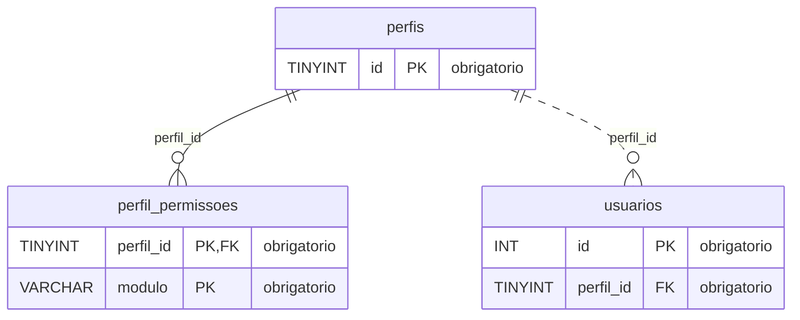
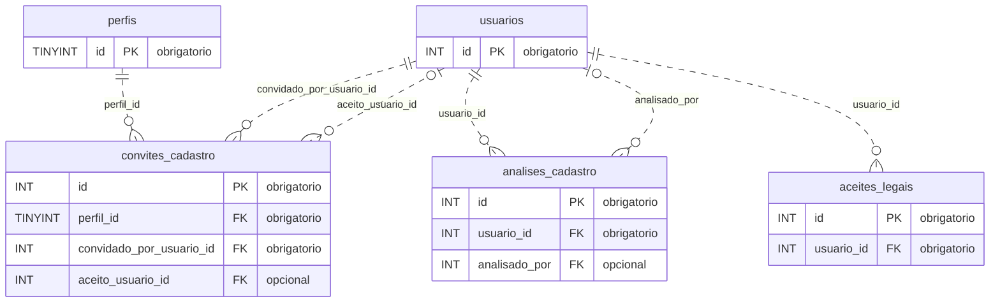
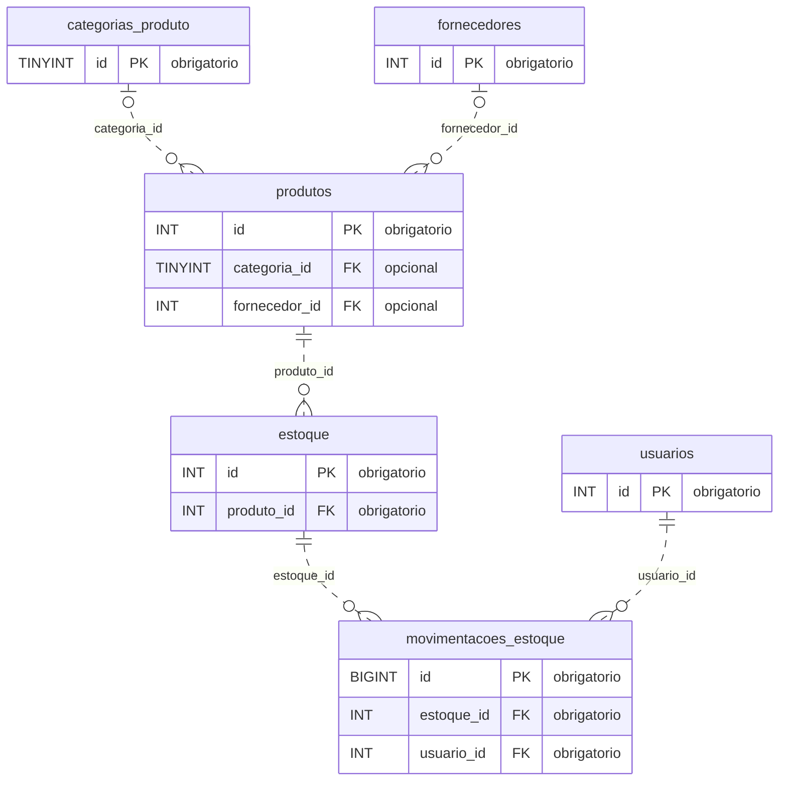
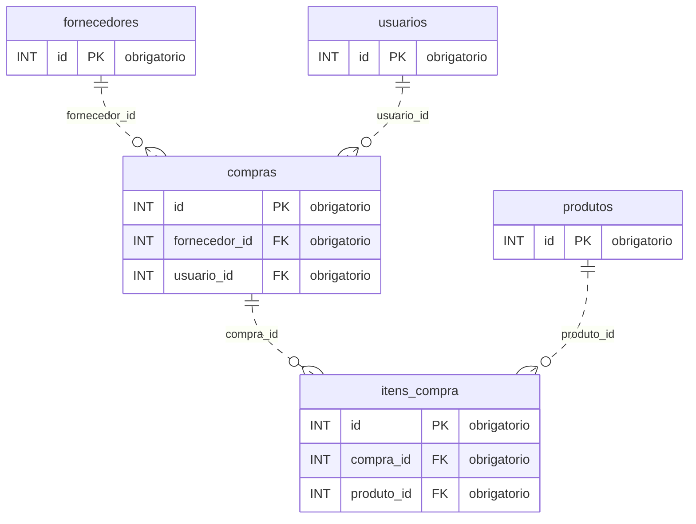
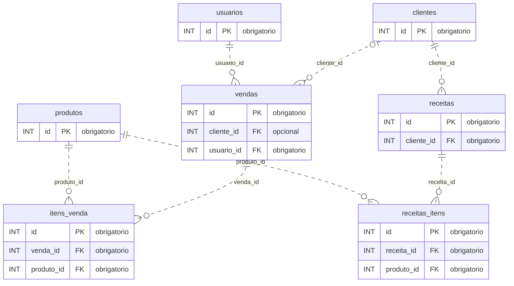
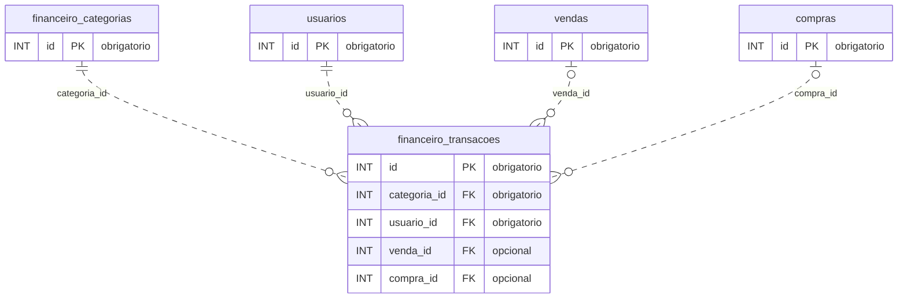
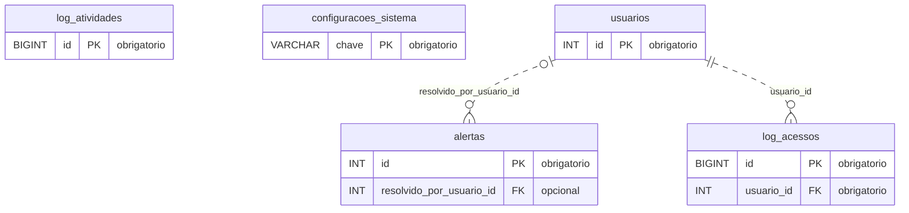

# Atlas EER do FarmaControl

**24 tabelas · 30 chaves estrangeiras · 7 áreas**

Referência visual conferida com o EER fornecido e gerada a partir do [schema SQL](../backend/schema.sql). Descreve a instalação nova; não representa uma inspeção do banco em execução. Consulte o [guia do banco](database_schema_design.md) para instalação e migrações.

## Como ler

- **PK**: chave primária; **FK**: chave estrangeira declarada no SQL.
- `||`: exatamente um; `o|` / `|o`: zero ou um; `o{`: zero ou muitos.
- Linha contínua: FK faz parte da PK do filho. Linha tracejada: relação não identificadora.
- Os diagramas mostram chaves. Tipos completos, demais colunas e índices aparecem no dicionário de cada área.
- Tabelas de apoio reaparecem apenas com sua PK. Os nomes nas linhas são as colunas FK do filho.

O GitHub renderiza os blocos Mermaid. Localmente, use a pré-visualização Markdown com suporte a Mermaid; as tabelas do dicionário também podem ser lidas sem esse suporte.

## Navegação

| Área | Tabelas |
| --- | --- |
| [Acesso e permissões](#acesso) | [`perfis`](#tabela-perfis), [`perfil_permissoes`](#tabela-perfil_permissoes), [`usuarios`](#tabela-usuarios) |
| [Cadastro e consentimento](#cadastro) | [`convites_cadastro`](#tabela-convites_cadastro), [`analises_cadastro`](#tabela-analises_cadastro), [`aceites_legais`](#tabela-aceites_legais) |
| [Catálogo e estoque](#estoque) | [`categorias_produto`](#tabela-categorias_produto), [`fornecedores`](#tabela-fornecedores), [`produtos`](#tabela-produtos), [`estoque`](#tabela-estoque), [`movimentacoes_estoque`](#tabela-movimentacoes_estoque) |
| [Compras](#compras) | [`compras`](#tabela-compras), [`itens_compra`](#tabela-itens_compra) |
| [Vendas e prescrições](#vendas) | [`clientes`](#tabela-clientes), [`vendas`](#tabela-vendas), [`itens_venda`](#tabela-itens_venda), [`receitas`](#tabela-receitas), [`receitas_itens`](#tabela-receitas_itens) |
| [Financeiro](#financeiro) | [`financeiro_categorias`](#tabela-financeiro_categorias), [`financeiro_transacoes`](#tabela-financeiro_transacoes) |
| [Operação e auditoria](#operacao) | [`alertas`](#tabela-alertas), [`log_acessos`](#tabela-log_acessos), [`log_atividades`](#tabela-log_atividades), [`configuracoes_sistema`](#tabela-configuracoes_sistema) |

## Referências que não são FKs

| Campo | Leitura correta |
| --- | --- |
| `log_atividades.usuario_id` | Sem FK; a identidade é preservada por snapshot em `usuario_nome` e `perfil`. |
| `alertas.referencia_id` | Referência interpretada pela aplicação; não existe uma FK de destino fixo. |
| `itens_venda.lote_vendido` / `itens_compra.lote_recebido` | Textos de lote; não possuem FK direta para `estoque`. |
| `configuracoes_sistema` | Tabela independente, identificada pela chave textual `chave`. |

Não há especialização/herança declarada entre tabelas. `tipo_produto` é um discriminador na própria tabela `produtos`.

## Acesso e permissões

**Dicionário da área** — expanda uma tabela para consultar suas colunas.

<strong>perfis</strong> · 5 colunas

| Coluna | Tipo SQL | Chave | Aceita NULL | Definição adicional |
| --- | --- | --- | --- | --- |
| `id` | `TINYINT UNSIGNED` | PK | Não | `AUTO_INCREMENT` |
| `slug` | `VARCHAR(30)` | UNIQUE | Não | — |
| `nome` | `VARCHAR(80)` | — | Não | — |
| `descricao` | `VARCHAR(255)` | — | Não | — |
| `criado_em` | `DATETIME` | — | Não | `DEFAULT CURRENT_TIMESTAMP` |

<strong>perfil_permissoes</strong> · 3 colunas

| Coluna | Tipo SQL | Chave | Aceita NULL | Definição adicional |
| --- | --- | --- | --- | --- |
| `perfil_id` | `TINYINT UNSIGNED` | PK; FK → `perfis.id` | Não | — |
| `modulo` | `VARCHAR(40)` | PK | Não | — |
| `permitido` | `TINYINT(1)` | — | Não | `DEFAULT 0` |

| FK | Destino | ON DELETE | ON UPDATE |
| --- | --- | --- | --- |
| `perfil_id` | [`perfis.id`](#tabela-perfis) | `CASCADE` | `CASCADE` |

<strong>usuarios</strong> · 12 colunas

| Coluna | Tipo SQL | Chave | Aceita NULL | Definição adicional |
| --- | --- | --- | --- | --- |
| `id` | `INT UNSIGNED` | PK | Não | `AUTO_INCREMENT` |
| `nome` | `VARCHAR(80)` | — | Não | — |
| `sobrenome` | `VARCHAR(80)` | — | Não | — |
| `email` | `VARCHAR(180)` | UNIQUE | Não | — |
| `senha_hash` | `VARCHAR(255)` | — | Não | — |
| `perfil_id` | `TINYINT UNSIGNED` | FK → `perfis.id` | Não | — |
| `status` | `ENUM('pendente','aprovado','rejeitado')` | — | Não | `DEFAULT 'pendente'` |
| `ultimo_login` | `DATETIME` | — | Sim | — |
| `token_reset` | `VARCHAR(255)` | — | Sim | — |
| `token_expira_em` | `DATETIME` | — | Sim | — |
| `criado_em` | `DATETIME` | — | Não | `DEFAULT CURRENT_TIMESTAMP` |
| `atualizado_em` | `DATETIME` | — | Não | `DEFAULT CURRENT_TIMESTAMP ON UPDATE CURRENT_TIMESTAMP` |

**Índices adicionais / unicidade composta**

- `INDEX idx_email (email)`
- `INDEX idx_status (status)`

| FK | Destino | ON DELETE | ON UPDATE |
| --- | --- | --- | --- |
| `perfil_id` | [`perfis.id`](#tabela-perfis) | `RESTRICT` | `CASCADE` |

## Cadastro e consentimento

**Dicionário da área** — expanda uma tabela para consultar suas colunas.

<strong>convites_cadastro</strong> · 12 colunas

| Coluna | Tipo SQL | Chave | Aceita NULL | Definição adicional |
| --- | --- | --- | --- | --- |
| `id` | `INT UNSIGNED` | PK | Não | `AUTO_INCREMENT` |
| `nome` | `VARCHAR(80)` | — | Não | — |
| `sobrenome` | `VARCHAR(80)` | — | Não | — |
| `email` | `VARCHAR(180)` | — | Não | — |
| `perfil_id` | `TINYINT UNSIGNED` | FK → `perfis.id` | Não | — |
| `convidado_por_usuario_id` | `INT UNSIGNED` | FK → `usuarios.id` | Não | — |
| `token_hash` | `CHAR(64)` | UNIQUE | Não | — |
| `status` | `ENUM('pendente','aceito','recusado','expirado')` | — | Não | `DEFAULT 'pendente'` |
| `expira_em` | `DATETIME` | — | Não | — |
| `respondido_em` | `DATETIME` | — | Sim | — |
| `aceito_usuario_id` | `INT UNSIGNED` | FK → `usuarios.id` | Sim | — |
| `criado_em` | `DATETIME` | — | Não | `DEFAULT CURRENT_TIMESTAMP` |

**Índices adicionais / unicidade composta**

- `INDEX idx_convites_email_status (email, status)`

| FK | Destino | ON DELETE | ON UPDATE |
| --- | --- | --- | --- |
| `perfil_id` | [`perfis.id`](#tabela-perfis) | `RESTRICT` | `CASCADE` |
| `convidado_por_usuario_id` | [`usuarios.id`](#tabela-usuarios) | `RESTRICT` | `CASCADE` |
| `aceito_usuario_id` | [`usuarios.id`](#tabela-usuarios) | `SET NULL` | `CASCADE` |

<strong>analises_cadastro</strong> · 6 colunas

| Coluna | Tipo SQL | Chave | Aceita NULL | Definição adicional |
| --- | --- | --- | --- | --- |
| `id` | `INT UNSIGNED` | PK | Não | `AUTO_INCREMENT` |
| `usuario_id` | `INT UNSIGNED` | FK → `usuarios.id` | Não | — |
| `analisado_por` | `INT UNSIGNED` | FK → `usuarios.id` | Sim | — |
| `decisao` | `ENUM('aprovado','rejeitado')` | — | Não | — |
| `motivo` | `VARCHAR(500)` | — | Sim | — |
| `analisado_em` | `DATETIME` | — | Não | `DEFAULT CURRENT_TIMESTAMP` |

| FK | Destino | ON DELETE | ON UPDATE |
| --- | --- | --- | --- |
| `usuario_id` | [`usuarios.id`](#tabela-usuarios) | `CASCADE` | `CASCADE` |
| `analisado_por` | [`usuarios.id`](#tabela-usuarios) | `SET NULL` | `CASCADE` |

<strong>aceites_legais</strong> · 6 colunas

| Coluna | Tipo SQL | Chave | Aceita NULL | Definição adicional |
| --- | --- | --- | --- | --- |
| `id` | `INT UNSIGNED` | PK | Não | `AUTO_INCREMENT` |
| `usuario_id` | `INT UNSIGNED` | FK → `usuarios.id` | Não | — |
| `termos_versao` | `VARCHAR(32)` | — | Não | — |
| `privacidade_versao` | `VARCHAR(32)` | — | Não | — |
| `aceito_em` | `DATETIME` | — | Não | `DEFAULT CURRENT_TIMESTAMP` |
| `ip` | `VARCHAR(64)` | — | Sim | — |

**Índices adicionais / unicidade composta**

- `INDEX idx_aceites_legais_usuario (usuario_id)`

| FK | Destino | ON DELETE | ON UPDATE |
| --- | --- | --- | --- |
| `usuario_id` | [`usuarios.id`](#tabela-usuarios) | `RESTRICT` | `CASCADE` |

## Catálogo e estoque

**Dicionário da área** — expanda uma tabela para consultar suas colunas.

<strong>categorias_produto</strong> · 5 colunas

| Coluna | Tipo SQL | Chave | Aceita NULL | Definição adicional |
| --- | --- | --- | --- | --- |
| `id` | `TINYINT UNSIGNED` | PK | Não | `AUTO_INCREMENT` |
| `nome` | `VARCHAR(100)` | UNIQUE | Não | — |
| `descricao` | `VARCHAR(255)` | — | Sim | — |
| `criado_em` | `DATETIME` | — | Não | `DEFAULT CURRENT_TIMESTAMP` |
| `atualizado_em` | `DATETIME` | — | Não | `DEFAULT CURRENT_TIMESTAMP ON UPDATE CURRENT_TIMESTAMP` |

<strong>fornecedores</strong> · 11 colunas

| Coluna | Tipo SQL | Chave | Aceita NULL | Definição adicional |
| --- | --- | --- | --- | --- |
| `id` | `INT UNSIGNED` | PK | Não | `AUTO_INCREMENT` |
| `nome_fantasia` | `VARCHAR(150)` | — | Não | — |
| `razao_social` | `VARCHAR(255)` | UNIQUE | Não | — |
| `cnpj` | `VARCHAR(18)` | UNIQUE | Não | — |
| `contato_nome` | `VARCHAR(100)` | — | Sim | — |
| `contato_telefone` | `VARCHAR(20)` | — | Sim | — |
| `contato_email` | `VARCHAR(180)` | — | Sim | — |
| `endereco` | `VARCHAR(255)` | — | Sim | — |
| `ativo` | `BOOLEAN` | — | Não | `DEFAULT TRUE` |
| `criado_em` | `DATETIME` | — | Não | `DEFAULT CURRENT_TIMESTAMP` |
| `atualizado_em` | `DATETIME` | — | Não | `DEFAULT CURRENT_TIMESTAMP ON UPDATE CURRENT_TIMESTAMP` |

<strong>produtos</strong> · 17 colunas

| Coluna | Tipo SQL | Chave | Aceita NULL | Definição adicional |
| --- | --- | --- | --- | --- |
| `id` | `INT UNSIGNED` | PK | Não | `AUTO_INCREMENT` |
| `nome` | `VARCHAR(255)` | — | Não | — |
| `tipo_produto` | `ENUM('medicamento', 'outro')` | — | Não | `DEFAULT 'medicamento'` |
| `exige_validade` | `BOOLEAN` | — | Não | `DEFAULT TRUE` |
| `nome_generico` | `VARCHAR(255)` | — | Sim | — |
| `descricao` | `TEXT` | — | Sim | — |
| `fabricante` | `VARCHAR(150)` | — | Sim | — |
| `preco_custo` | `DECIMAL(10, 2)` | — | Não | — |
| `preco_venda` | `DECIMAL(10, 2)` | — | Não | — |
| `codigo_barras` | `VARCHAR(50)` | UNIQUE | Sim | — |
| `categoria_id` | `TINYINT UNSIGNED` | FK → `categorias_produto.id` | Sim | — |
| `requer_receita` | `BOOLEAN` | — | Não | `DEFAULT FALSE` |
| `ativo` | `BOOLEAN` | — | Não | `DEFAULT TRUE` |
| `estoque_minimo` | `INT UNSIGNED` | — | Não | `DEFAULT 10` |
| `fornecedor_id` | `INT UNSIGNED` | FK → `fornecedores.id` | Sim | — |
| `criado_em` | `DATETIME` | — | Não | `DEFAULT CURRENT_TIMESTAMP` |
| `atualizado_em` | `DATETIME` | — | Não | `DEFAULT CURRENT_TIMESTAMP ON UPDATE CURRENT_TIMESTAMP` |

| FK | Destino | ON DELETE | ON UPDATE |
| --- | --- | --- | --- |
| `categoria_id` | [`categorias_produto.id`](#tabela-categorias_produto) | `SET NULL` | `CASCADE` |
| `fornecedor_id` | [`fornecedores.id`](#tabela-fornecedores) | `SET NULL` | `CASCADE` |

<strong>estoque</strong> · 8 colunas

| Coluna | Tipo SQL | Chave | Aceita NULL | Definição adicional |
| --- | --- | --- | --- | --- |
| `id` | `INT UNSIGNED` | PK | Não | `AUTO_INCREMENT` |
| `produto_id` | `INT UNSIGNED` | FK → `produtos.id` | Não | — |
| `lote` | `VARCHAR(50)` | — | Não | — |
| `quantidade` | `INT UNSIGNED` | — | Não | — |
| `data_validade` | `DATE` | — | Sim | — |
| `localizacao` | `VARCHAR(100)` | — | Sim | — |
| `criado_em` | `DATETIME` | — | Não | `DEFAULT CURRENT_TIMESTAMP` |
| `atualizado_em` | `DATETIME` | — | Não | `DEFAULT CURRENT_TIMESTAMP ON UPDATE CURRENT_TIMESTAMP` |

**Índices adicionais / unicidade composta**

- `UNIQUE KEY uk_produto_lote (produto_id, lote)`

| FK | Destino | ON DELETE | ON UPDATE |
| --- | --- | --- | --- |
| `produto_id` | [`produtos.id`](#tabela-produtos) | `RESTRICT` | `CASCADE` |

<strong>movimentacoes_estoque</strong> · 7 colunas

| Coluna | Tipo SQL | Chave | Aceita NULL | Definição adicional |
| --- | --- | --- | --- | --- |
| `id` | `BIGINT UNSIGNED` | PK | Não | `AUTO_INCREMENT` |
| `estoque_id` | `INT UNSIGNED` | FK → `estoque.id` | Não | — |
| `usuario_id` | `INT UNSIGNED` | FK → `usuarios.id` | Não | — |
| `tipo_movimentacao` | `ENUM('entrada', 'saida', 'ajuste', 'transferencia')` | — | Não | — |
| `quantidade` | `INT` | — | Não | — |
| `observacao` | `VARCHAR(255)` | — | Sim | — |
| `data_movimentacao` | `DATETIME` | — | Não | `DEFAULT CURRENT_TIMESTAMP` |

| FK | Destino | ON DELETE | ON UPDATE |
| --- | --- | --- | --- |
| `estoque_id` | [`estoque.id`](#tabela-estoque) | `RESTRICT` | `CASCADE` |
| `usuario_id` | [`usuarios.id`](#tabela-usuarios) | `RESTRICT` | `CASCADE` |

## Compras

**Dicionário da área** — expanda uma tabela para consultar suas colunas.

<strong>compras</strong> · 9 colunas

| Coluna | Tipo SQL | Chave | Aceita NULL | Definição adicional |
| --- | --- | --- | --- | --- |
| `id` | `INT UNSIGNED` | PK | Não | `AUTO_INCREMENT` |
| `fornecedor_id` | `INT UNSIGNED` | FK → `fornecedores.id` | Não | — |
| `usuario_id` | `INT UNSIGNED` | FK → `usuarios.id` | Não | — |
| `data_pedido` | `DATETIME` | — | Não | `DEFAULT CURRENT_TIMESTAMP` |
| `data_recebimento` | `DATETIME` | — | Sim | — |
| `valor_total` | `DECIMAL(10, 2)` | — | Não | — |
| `status` | `ENUM('pendente', 'recebido', 'cancelado')` | — | Não | `DEFAULT 'pendente'` |
| `criado_em` | `DATETIME` | — | Não | `DEFAULT CURRENT_TIMESTAMP` |
| `atualizado_em` | `DATETIME` | — | Não | `DEFAULT CURRENT_TIMESTAMP ON UPDATE CURRENT_TIMESTAMP` |

| FK | Destino | ON DELETE | ON UPDATE |
| --- | --- | --- | --- |
| `fornecedor_id` | [`fornecedores.id`](#tabela-fornecedores) | `RESTRICT` | `CASCADE` |
| `usuario_id` | [`usuarios.id`](#tabela-usuarios) | `RESTRICT` | `CASCADE` |

<strong>itens_compra</strong> · 7 colunas

| Coluna | Tipo SQL | Chave | Aceita NULL | Definição adicional |
| --- | --- | --- | --- | --- |
| `id` | `INT UNSIGNED` | PK | Não | `AUTO_INCREMENT` |
| `compra_id` | `INT UNSIGNED` | FK → `compras.id` | Não | — |
| `produto_id` | `INT UNSIGNED` | FK → `produtos.id` | Não | — |
| `quantidade` | `INT UNSIGNED` | — | Não | — |
| `preco_unitario` | `DECIMAL(10, 2)` | — | Não | — |
| `lote_recebido` | `VARCHAR(50)` | — | Sim | — |
| `data_validade_recebida` | `DATE` | — | Sim | — |

| FK | Destino | ON DELETE | ON UPDATE |
| --- | --- | --- | --- |
| `compra_id` | [`compras.id`](#tabela-compras) | `CASCADE` | `CASCADE` |
| `produto_id` | [`produtos.id`](#tabela-produtos) | `RESTRICT` | `CASCADE` |

## Vendas e prescrições

**Dicionário da área** — expanda uma tabela para consultar suas colunas.

<strong>clientes</strong> · 10 colunas

| Coluna | Tipo SQL | Chave | Aceita NULL | Definição adicional |
| --- | --- | --- | --- | --- |
| `id` | `INT UNSIGNED` | PK | Não | `AUTO_INCREMENT` |
| `nome` | `VARCHAR(80)` | — | Não | — |
| `sobrenome` | `VARCHAR(80)` | — | Não | — |
| `cpf` | `VARCHAR(14)` | UNIQUE | Sim | — |
| `telefone` | `VARCHAR(20)` | — | Sim | — |
| `email` | `VARCHAR(180)` | UNIQUE | Sim | — |
| `endereco` | `VARCHAR(255)` | — | Sim | — |
| `data_nascimento` | `DATE` | — | Sim | — |
| `criado_em` | `DATETIME` | — | Não | `DEFAULT CURRENT_TIMESTAMP` |
| `atualizado_em` | `DATETIME` | — | Não | `DEFAULT CURRENT_TIMESTAMP ON UPDATE CURRENT_TIMESTAMP` |

<strong>vendas</strong> · 9 colunas

| Coluna | Tipo SQL | Chave | Aceita NULL | Definição adicional |
| --- | --- | --- | --- | --- |
| `id` | `INT UNSIGNED` | PK | Não | `AUTO_INCREMENT` |
| `cliente_id` | `INT UNSIGNED` | FK → `clientes.id` | Sim | — |
| `usuario_id` | `INT UNSIGNED` | FK → `usuarios.id` | Não | — |
| `data_venda` | `DATETIME` | — | Não | `DEFAULT CURRENT_TIMESTAMP` |
| `valor_total` | `DECIMAL(10, 2)` | — | Não | — |
| `tipo_pagamento` | `ENUM('dinheiro', 'cartao_credito', 'cartao_debito', 'pix')` | — | Não | — |
| `status` | `ENUM('concluida', 'cancelada', 'pendente')` | — | Não | `DEFAULT 'pendente'` |
| `criado_em` | `DATETIME` | — | Não | `DEFAULT CURRENT_TIMESTAMP` |
| `atualizado_em` | `DATETIME` | — | Não | `DEFAULT CURRENT_TIMESTAMP ON UPDATE CURRENT_TIMESTAMP` |

| FK | Destino | ON DELETE | ON UPDATE |
| --- | --- | --- | --- |
| `cliente_id` | [`clientes.id`](#tabela-clientes) | `SET NULL` | `CASCADE` |
| `usuario_id` | [`usuarios.id`](#tabela-usuarios) | `RESTRICT` | `CASCADE` |

<strong>itens_venda</strong> · 7 colunas

| Coluna | Tipo SQL | Chave | Aceita NULL | Definição adicional |
| --- | --- | --- | --- | --- |
| `id` | `INT UNSIGNED` | PK | Não | `AUTO_INCREMENT` |
| `venda_id` | `INT UNSIGNED` | FK → `vendas.id` | Não | — |
| `produto_id` | `INT UNSIGNED` | FK → `produtos.id` | Não | — |
| `quantidade` | `INT UNSIGNED` | — | Não | — |
| `preco_unitario` | `DECIMAL(10, 2)` | — | Não | — |
| `desconto` | `DECIMAL(5, 2)` | — | Não | `DEFAULT 0.00` |
| `lote_vendido` | `VARCHAR(50)` | — | Sim | — |

| FK | Destino | ON DELETE | ON UPDATE |
| --- | --- | --- | --- |
| `venda_id` | [`vendas.id`](#tabela-vendas) | `CASCADE` | `CASCADE` |
| `produto_id` | [`produtos.id`](#tabela-produtos) | `RESTRICT` | `CASCADE` |

<strong>receitas</strong> · 10 colunas

| Coluna | Tipo SQL | Chave | Aceita NULL | Definição adicional |
| --- | --- | --- | --- | --- |
| `id` | `INT UNSIGNED` | PK | Não | `AUTO_INCREMENT` |
| `cliente_id` | `INT UNSIGNED` | FK → `clientes.id` | Não | — |
| `medico_nome` | `VARCHAR(150)` | — | Não | — |
| `crm` | `VARCHAR(20)` | — | Não | — |
| `data_prescricao` | `DATE` | — | Não | — |
| `data_validade` | `DATE` | — | Sim | — |
| `observacoes` | `TEXT` | — | Sim | — |
| `arquivo_receita_url` | `VARCHAR(255)` | — | Sim | — |
| `criado_em` | `DATETIME` | — | Não | `DEFAULT CURRENT_TIMESTAMP` |
| `atualizado_em` | `DATETIME` | — | Não | `DEFAULT CURRENT_TIMESTAMP ON UPDATE CURRENT_TIMESTAMP` |

| FK | Destino | ON DELETE | ON UPDATE |
| --- | --- | --- | --- |
| `cliente_id` | [`clientes.id`](#tabela-clientes) | `RESTRICT` | `CASCADE` |

<strong>receitas_itens</strong> · 6 colunas

| Coluna | Tipo SQL | Chave | Aceita NULL | Definição adicional |
| --- | --- | --- | --- | --- |
| `id` | `INT UNSIGNED` | PK | Não | `AUTO_INCREMENT` |
| `receita_id` | `INT UNSIGNED` | FK → `receitas.id` | Não | — |
| `produto_id` | `INT UNSIGNED` | FK → `produtos.id` | Não | — |
| `quantidade` | `INT UNSIGNED` | — | Não | — |
| `dosagem` | `VARCHAR(100)` | — | Sim | — |
| `instrucoes_uso` | `TEXT` | — | Sim | — |

| FK | Destino | ON DELETE | ON UPDATE |
| --- | --- | --- | --- |
| `receita_id` | [`receitas.id`](#tabela-receitas) | `CASCADE` | `CASCADE` |
| `produto_id` | [`produtos.id`](#tabela-produtos) | `RESTRICT` | `CASCADE` |

## Financeiro

**Dicionário da área** — expanda uma tabela para consultar suas colunas.

<strong>financeiro_categorias</strong> · 5 colunas

| Coluna | Tipo SQL | Chave | Aceita NULL | Definição adicional |
| --- | --- | --- | --- | --- |
| `id` | `INT UNSIGNED` | PK | Não | `AUTO_INCREMENT` |
| `nome` | `VARCHAR(80)` | — | Não | — |
| `tipo` | `ENUM('receita', 'despesa')` | — | Não | — |
| `slug` | `VARCHAR(40)` | UNIQUE | Não | — |
| `criado_em` | `DATETIME` | — | Não | `DEFAULT CURRENT_TIMESTAMP` |

<strong>financeiro_transacoes</strong> · 12 colunas

| Coluna | Tipo SQL | Chave | Aceita NULL | Definição adicional |
| --- | --- | --- | --- | --- |
| `id` | `INT UNSIGNED` | PK | Não | `AUTO_INCREMENT` |
| `categoria_id` | `INT UNSIGNED` | FK → `financeiro_categorias.id` | Não | — |
| `usuario_id` | `INT UNSIGNED` | FK → `usuarios.id` | Não | — |
| `venda_id` | `INT UNSIGNED` | FK → `vendas.id` | Sim | — |
| `compra_id` | `INT UNSIGNED` | FK → `compras.id` | Sim | — |
| `descricao` | `VARCHAR(255)` | — | Não | — |
| `valor` | `DECIMAL(12, 2)` | — | Não | — |
| `data_transacao` | `DATETIME` | — | Não | `DEFAULT CURRENT_TIMESTAMP` |
| `status` | `ENUM('pago', 'pendente', 'cancelado')` | — | Não | `DEFAULT 'pago'` |
| `metodo_pagamento` | `ENUM('dinheiro', 'cartao_credito', 'cartao_debito', 'pix', 'boleto', 'transferencia')` | — | Não | — |
| `criado_em` | `DATETIME` | — | Não | `DEFAULT CURRENT_TIMESTAMP` |
| `atualizado_em` | `DATETIME` | — | Não | `DEFAULT CURRENT_TIMESTAMP ON UPDATE CURRENT_TIMESTAMP` |

**Índices adicionais / unicidade composta**

- `INDEX idx_data (data_transacao)`

| FK | Destino | ON DELETE | ON UPDATE |
| --- | --- | --- | --- |
| `categoria_id` | [`financeiro_categorias.id`](#tabela-financeiro_categorias) | `RESTRICT` | `CASCADE` |
| `usuario_id` | [`usuarios.id`](#tabela-usuarios) | `RESTRICT` | `CASCADE` |
| `venda_id` | [`vendas.id`](#tabela-vendas) | `SET NULL` | `CASCADE` |
| `compra_id` | [`compras.id`](#tabela-compras) | `SET NULL` | `CASCADE` |

## Operação e auditoria

**Dicionário da área** — expanda uma tabela para consultar suas colunas.

<strong>alertas</strong> · 9 colunas

| Coluna | Tipo SQL | Chave | Aceita NULL | Definição adicional |
| --- | --- | --- | --- | --- |
| `id` | `INT UNSIGNED` | PK | Não | `AUTO_INCREMENT` |
| `tipo_alerta` | `VARCHAR(30)` | — | Não | — |
| `referencia_id` | `INT` | — | Sim | — |
| `mensagem` | `TEXT` | — | Não | — |
| `status` | `VARCHAR(20)` | — | Não | `DEFAULT 'ativo'` |
| `resolvido_em` | `DATETIME` | — | Sim | — |
| `resolvido_por_usuario_id` | `INT UNSIGNED` | FK → `usuarios.id` | Sim | — |
| `criado_em` | `DATETIME` | — | Não | `DEFAULT CURRENT_TIMESTAMP` |
| `atualizado_em` | `DATETIME` | — | Não | `DEFAULT CURRENT_TIMESTAMP ON UPDATE CURRENT_TIMESTAMP` |

**Índices adicionais / unicidade composta**

- `INDEX idx_alertas_tipo (tipo_alerta)`
- `INDEX idx_alertas_status (status)`
- `INDEX idx_alertas_resolvido_por (resolvido_por_usuario_id)`

| FK | Destino | ON DELETE | ON UPDATE |
| --- | --- | --- | --- |
| `resolvido_por_usuario_id` | [`usuarios.id`](#tabela-usuarios) | `SET NULL` | `CASCADE` |

<strong>log_acessos</strong> · 7 colunas

| Coluna | Tipo SQL | Chave | Aceita NULL | Definição adicional |
| --- | --- | --- | --- | --- |
| `id` | `BIGINT UNSIGNED` | PK | Não | `AUTO_INCREMENT` |
| `usuario_id` | `INT UNSIGNED` | FK → `usuarios.id` | Não | — |
| `ip` | `VARCHAR(45)` | — | Sim | — |
| `user_agent` | `VARCHAR(500)` | — | Sim | — |
| `sucesso` | `TINYINT(1)` | — | Não | `DEFAULT 1` |
| `motivo_falha` | `VARCHAR(200)` | — | Sim | — |
| `criado_em` | `DATETIME` | — | Não | `DEFAULT CURRENT_TIMESTAMP` |

| FK | Destino | ON DELETE | ON UPDATE |
| --- | --- | --- | --- |
| `usuario_id` | [`usuarios.id`](#tabela-usuarios) | `CASCADE` | `CASCADE` |

<strong>log_atividades</strong> · 8 colunas

| Coluna | Tipo SQL | Chave | Aceita NULL | Definição adicional |
| --- | --- | --- | --- | --- |
| `id` | `BIGINT UNSIGNED` | PK | Não | `AUTO_INCREMENT` |
| `usuario_id` | `INT` | — | Sim | — |
| `usuario_nome` | `VARCHAR(255)` | — | Não | — |
| `perfil` | `VARCHAR(40)` | — | Não | — |
| `acao` | `VARCHAR(255)` | — | Não | — |
| `detalhes` | `MEDIUMTEXT` | — | Não | — |
| `status_http` | `SMALLINT UNSIGNED` | — | Não | — |
| `criado_em` | `DATETIME` | — | Não | `DEFAULT (UTC_TIMESTAMP())` |

**Índices adicionais / unicidade composta**

- `INDEX idx_log_usuario (usuario_id, id)`

<strong>configuracoes_sistema</strong> · 5 colunas

| Coluna | Tipo SQL | Chave | Aceita NULL | Definição adicional |
| --- | --- | --- | --- | --- |
| `chave` | `VARCHAR(120)` | PK | Não | — |
| `valor` | `TEXT` | — | Sim | — |
| `descricao` | `VARCHAR(255)` | — | Sim | — |
| `criado_em` | `TIMESTAMP` | — | Sim | `DEFAULT CURRENT_TIMESTAMP` |
| `atualizado_em` | `TIMESTAMP` | — | Sim | `DEFAULT CURRENT_TIMESTAMP ON UPDATE CURRENT_TIMESTAMP` |

## Atualização desta referência

O gerador [`scripts/database_docs.py`](../scripts/database_docs.py) lê apenas o schema e emite este Markdown. Depois de mudar o SQL, gere novamente, confira os diagramas e atualize a documentação. As relações mostradas são somente as FKs declaradas; regras transacionais da aplicação não criam novas FKs.
