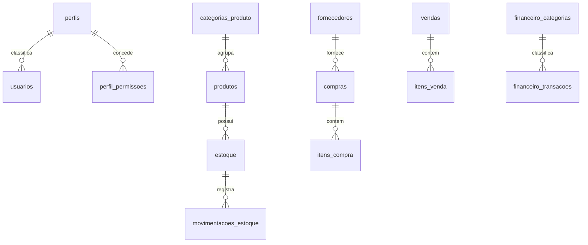

# Banco de dados — FarmaControl

Revisado em **19/10/2026** a partir do [schema](../backend/schema.sql) e das [migrações](../backend/migrations). Esta revisão não consultou nem alterou um servidor de banco.

## Instalação e compatibilidade

O schema cria a base `farmacontrol` com `utf8mb4` e tabelas InnoDB. Inclui 24 tabelas, roles técnicas, perfis, categorias e configurações iniciais. Não cria automaticamente uma conta administrativa da aplicação com senha.

Use-o em uma instalação nova. Em base existente, compare estrutura e migrações; `CREATE TABLE IF NOT EXISTS` não atualiza todas as colunas, índices ou dados de uma tabela antiga. O arquivo contém instruções específicas de MySQL, inclusive roles e concessões: compatibilidade com MariaDB precisa ser conferida na versão de destino.

## Tabelas

| Tabela | Responsabilidade |
| --- | --- |
| `perfis` | Cargos funcionais da aplicação |
| `perfil_permissoes` | Módulos concedidos por perfil e consultados pelo middleware |
| `usuarios` | Identidade, senha bcrypt, perfil, status e recuperação |
| `analises_cadastro` | Decisões de aprovação/rejeição |
| `log_acessos` | Registros de tentativas de acesso |
| `clientes` | Clientes vinculáveis a vendas e receitas |
| `categorias_produto` | Classificação comercial |
| `fornecedores` | Fornecedores de produtos/compras |
| `produtos` | Cadastro comercial, tipo, preços e regras de validade/receita |
| `estoque` | Saldo por produto/lote e validade |
| `movimentacoes_estoque` | Histórico de alterações de saldo |
| `compras` | Cabeçalho e estado do pedido |
| `itens_compra` | Produtos, quantidades e dados de recebimento |
| `vendas` | Cabeçalho, pagamento e estado da venda |
| `itens_venda` | Produtos e lotes vendidos |
| `receitas` | Prescrições vinculadas a clientes |
| `receitas_itens` | Itens e informações de prescrição |
| `configuracoes_sistema` | Preferências e marcadores operacionais |
| `aceites_legais` | Versões dos documentos aceitos por usuário |
| `convites_cadastro` | Convites, hashes de token, validade e consumo |
| `alertas` | Alertas e seu estado de resolução |
| `financeiro_categorias` | Classificação financeira |
| `financeiro_transacoes` | Valores, estado, pagamento e vínculos operacionais |
| `log_atividades` | Autor, ação, entidade e detalhes de auditoria |

## Relações principais

O diagrama é resumido. Colunas, nulabilidade, índices e políticas de exclusão têm como referência o SQL. Não remova vínculos para contornar a retenção do histórico.

## Regras de dados

`tipo_produto` distingue `medicamento` de `outro`; categoria não determina o tipo. Medicamentos exigem validade e podem ter princípio ativo/receita. Outros produtos podem desabilitar a exigência de validade e não mantêm os campos exclusivos de medicamento.

Validade ausente é `NULL`. Datas informadas continuam sendo acompanhadas. `SEM-LOTE` representa lote não informado quando o controle não exige identificação. Produtos de mesmo cadastro com validades distintas devem usar lotes distintos.

Preços e valores usam DECIMAL. A compra recebida valida os itens enviados, atualiza estoque e registra os efeitos dentro do fluxo transacional. O PDV bloqueia lotes, recalcula preços e confirma venda, itens, saldo, movimentações, financeiro e auditoria em conjunto.

Usuários, convites, recuperação e aceites possuem finalidades diferentes. Tokens de convite/recuperação são armazenados como hashes. Alterar senha não requer nem permite recuperar a senha anterior em texto.

## Migrações existentes

| Arquivo/prefixo | Finalidade |
| --- | --- |
| `002_adiciona_perfil_visualizador.sql` | Perfil de consulta |
| `002_fix_query_get_compras.sql` | Registro da correção da consulta de compras |
| `003` | Validade de estoque anulável |
| `004` | Tabela de alertas |
| `005` | Estrutura financeira e dados de demonstração |
| `006` | Permissões de módulos adicionais |
| `007` | Alertas, aceites e configurações |
| `008` | Convites de cadastro |
| `009` | Recuperação de senha |
| `010` | Padronização de perfis e visualizador |
| `011` | Remoção das antigas preferências de tema |
| `012` | Catálogo de medicamentos e outros produtos |
| `013` (opcional) | Limpeza de todos os dados: destrutiva |
| `014` (opcional) | Usuário de teste com credenciais públicas |
| `015` | Roles técnicas MySQL |
| `016` | Log de atividades |
| `017` (opcional) | Carga fictícia de farmácia |
| `018` | Reconciliação de vendas e financeiro |
| `019` | Reorganização de categorias comerciais |
| `020` | Ampliação dos detalhes de auditoria |
| `021` | Remoção das permissões de Previsão IA |
| `20261005_perfil_permissoes.sql` | Matriz de permissões por perfil |

Os dois arquivos 002 têm finalidades distintas e foram preservados. A numeração não define um comando automático seguro para qualquer banco. Leia os pré-requisitos e efeitos de cada arquivo; migrações podem atualizar dados além da estrutura.

### Procedimento para atualizar uma base

1. Confirme servidor, versão e base selecionada.
2. Faça backup completo e confira a possibilidade de restauração.
3. Compare as tabelas/colunas instaladas com o schema e as mudanças necessárias.
4. Teste as migrações pertinentes em uma cópia descartável.
5. Aplique no ambiente escolhido em uma janela apropriada e reinicie a API.
6. Valide login, permissões e os fluxos afetados com dados controlados.

`scripts/migrate_catalogo.py` inspeciona/aplica o catálogo e categorias; `scripts/migrate_audit.py` inspeciona/aplica alterações de auditoria. O uso de `--apply` é explícito e deve ocorrer somente após conferir o banco configurado no `.env`.

## Dados de demonstração

A carga 017 cria um cenário fictício com 28 usuários, 20 fornecedores, 500 clientes, 200 produtos, 600 lotes, 800 compras e 6.000 vendas, além de itens e históricos. A configuração padrão simula 180 dias; leia o SQL antes de ajustar parâmetros.

Ela usa o marcador `seed.farmacia.017` para evitar duplicação. O proprietário de demonstração é `usuario001@farmacia.example.invalid`, com senha pública `FarmaciaTeste@2026`. A migração 014 é outro utilitário de teste e também contém credencial pública. Não use essas contas em uma base operacional.

O script 013 apaga dados; não faz parte do procedimento comum de instalação ou atualização. Os scripts 005 e 017 também alteram conteúdo, portanto não devem ser tratados como simples criação de tabelas.

## Roles técnicas e contas da aplicação

| Role MySQL | Uso |
| --- | --- |
| `fc_runtime_rw` | Conta técnica do backend |
| `fc_schema_deployer` | Alterações de estrutura e migrações |
| `fc_support_ro` | Consulta e diagnóstico |
| `fc_database_admin` | Administração do banco |

Essas roles não são os perfis funcionais salvos em `perfis`. O schema/migração cria roles, mas não define senhas nem atribui contas reais automaticamente. Consulte os exemplos no [backend](../backend/README.md).

## Backup e validação

O banco não está dentro do repositório. Preserve estrutura, dados e rotinas necessárias em backup separado; não versione exportações com dados reais. Siga [transferência](TRANSFERENCIA.md) para migração entre máquinas.

Testes unitários usam banco simulado. `check_catalogo_mysql.py` e `check_seed_mysql.py` são verificações adicionais com bases temporárias e privilégios próprios. A revisão documental de 19/10 não executou esses scripts nem confirmou as migrações instaladas.
